# EffectCraft — Architecture Notes

## 1. Overview
EffectCraft is a clean-room, open-source motion graphics and visual effects application built in pure Rust. It is engineered with strict reliability rules ("Never Crash"), a deterministic command-based state model, exact integer tick-based timeline synchronization, and agent-drivable control channels.

## 2. Entry Point
- **Desktop Application (GUI):**
  - **File:** `apps/effectcraft/src/main.rs`
  - **Function:** `fn main() -> eframe::Result`
  - **Lifecycle:**
    1. Installs logger and panic hook (`effectcraft_engine::logging::install_panic_hook`).
    2. Parses arguments (`--control`, `--demo`, `--home`, `*.ecproj`).
    3. Initializes session (`effectcraft_host::session()`), loads settings, restores window state.
    4. Configures `eframe::NativeOptions` and launches `eframe::run_native` with `EffectcraftApp`.
- **Command Line & MCP Server (Headless CLI):**
  - **File:** `apps/effectcraft-cli/src/main.rs`
  - **Function:** `fn main()`
- **WebAssembly Application:**
  - **File:** `apps/effectcraft-web/src/lib.rs`

## 3. Module Hierarchy & Directory Layout

EffectCraft follows a strict 7-layer dependency architecture (enforced by `cargo xtask layers`):

```mermaid
flowchart TD
    subgraph L6_Apps ["L6: Applications (apps/)"]
        AppGUI["apps/effectcraft (Desktop GUI)"]
        AppCLI["apps/effectcraft-cli (CLI & MCP Server)"]
        AppWeb["apps/effectcraft-web (WebAssembly App)"]
    end

    subgraph L5_UI_Auto ["L5: UI & Automation"]
        UI["crates/ui-egui (Docking, Timeline, Viewer, Graph Editor)"]
        Automation["crates/automation (MCP Server & Agent Tools)"]
    end

    subgraph L4_Engine ["L4: Engine & Session Host"]
        Host["crates/host (Full session integration)"]
        Engine["crates/engine (Undo/Redo History, Command Registry, Session)"]
        Script["crates/script (JSX scripting, ScriptUI dialogs)"]
    end

    subgraph L3_Render_IO ["L3: Render, Media, Export & Plugins"]
        Render["crates/render (Comp Graph, Blending, Motion Blur, 3D Camera)"]
        GPU["crates/gpu (WGPU compute shaders & GPU Compositor)"]
        Media["crates/media (Footage decoding & Frame cache)"]
        Export["crates/export (H.264, HEVC, AV1, ProRes, WebM, GIF, EXR)"]
        Expr["crates/expr (JavaScript expressions via Boa Engine)"]
        Plugin["crates/plugin (Wasm sandboxed effect plugins)"]
        Interchange["crates/interchange (EDL, FCPXML, OTIO interop)"]
        Lottie["crates/lottie (Import/Export Lottie JSON)"]
    end

    subgraph L2_Data_Effects ["L2: Project Model & Effects"]
        Project["crates/project (Project, Comp, Layer, PropGroup tree)"]
        Effects["crates/effects (306 built-in CPU effects)"]
        VectorFormats["crates/svg, crates/pdf, crates/model (glTF/OBJ)"]
        Text["crates/text (HarfRust shaping & Glyphs)"]
    end

    subgraph L1_L0_Foundation ["L0 - L1: Foundation, Math & Codecs"]
        Raster["crates/raster (Float buffers, Parallel warps/blurs)"]
        Keyframe["crates/keyframe (Eased/Bezier keyframes)"]
        Math["crates/time (Tick time), crates/geom, crates/color"]
        Codecs["crates/vp9enc, crates/opusenc, crates/hevcenc, crates/av1enc"]
    end

    L6_Apps --> L5_UI_Auto
    L5_UI_Auto --> L4_Engine
    L4_Engine --> L3_Render_IO
    L3_Render_IO --> L2_Data_Effects
    L2_Data_Effects --> L1_L0_Foundation
```

### Module Responsibilities

| Layer | Module / Directory | Responsibility |
| :--- | :--- | :--- |
| **L6** | `apps/effectcraft` | Desktop GUI entry point, window management, launch guard, control server. |
| **L6** | `apps/effectcraft-cli` | Headless CLI, frame rendering, batch operations, MCP server over stdio. |
| **L6** | `apps/effectcraft-web` | WebAssembly frontend targeting wasm32. |
| **L5** | `crates/ui-egui` | Desktop GUI (egui), docking, Timeline, Viewer, Graph Editor, Effect Controls. |
| **L5** | `crates/automation` | Model Context Protocol (MCP) server implementation for AI agents. |
| **L4** | `crates/engine` | Session state, undo/redo history, command registry, preferences. |
| **L4** | `crates/host` | Session assembly wiring engine with media, codecs, scripting, and plugins. |
| **L4** | `crates/script` | JavaScript scripting engine (JSX / ScriptUI) driving engine commands. |
| **L3** | `crates/render` | Frame evaluation, compositing pipeline, masks, blend modes, 3D camera. |
| **L3** | `crates/gpu` | Hardware acceleration via WGPU compute shaders. |
| **L3** | `crates/media` | Video/audio decoding, frame caching, FilmCraft codecs integration. |
| **L3** | `crates/export` | Render queue exporter (H.264, HEVC, AV1, ProRes, WebM, GIF, EXR). |
| **L3** | `crates/expr` | JavaScript expression engine (`boa_engine`) with AE object model. |
| **L3** | `crates/plugin` | Sandboxed WebAssembly effect plugin runtime (`wasmi`). |
| **L2** | `crates/project` | Project schema (`.ecproj`, `.ecprojx`), Compositions, Layers, Property Tree. |
| **L2** | `crates/effects` | 306 built-in CPU visual effects and generators. |
| **L1** | `crates/raster` | Premultiplied float image buffers, sampling, parallel warps, blurs. |
| **L1** | `crates/keyframe` | Keyframe interpolation (linear, Bezier, ease, roving, hold). |
| **L0** | `crates/time` | Discrete integer `Tick` time (254,016,000,000 per second), timecode formats. |
| **L0** | `crates/geom` / `color` | Transform matrices, vectors, quaternions, color spaces, blend formulas. |
| **Tooling**| `xtask/` | Quality gates (`ci`, `layers`, `assets`, `corpus`). |

## 4. Key Architectural Principles
- **Never Crash:** No `unwrap()`, `expect()`, `panic!` in non-test code; all failures use `Result<T, E>`.
- **Pure Rust & Clean-Room:** No GPL/LGPL/AGPL code, zero proprietary Adobe binaries or reverse-engineered headers.
- **Deterministic State:** Every change runs through the `Command` registry (`session.execute("cmd.id", params)`).
- **Exact Integer Time:** Timeline time is tracked in discrete `Tick` units to eliminate floating-point drift.

## 5. Build and Test Commands
- Run Desktop App: `cargo run -p effectcraft` (or `cargo run --release -p effectcraft`)
- Run CLI: `cargo run -p effectcraft-cli -- info`
- Type Check: `cargo check --workspace`
- Verify Dependency Layering: `cargo xtask layers`
- Run Tests: `cargo test`
- Run Full CI Quality Gates: `cargo xtask ci`
